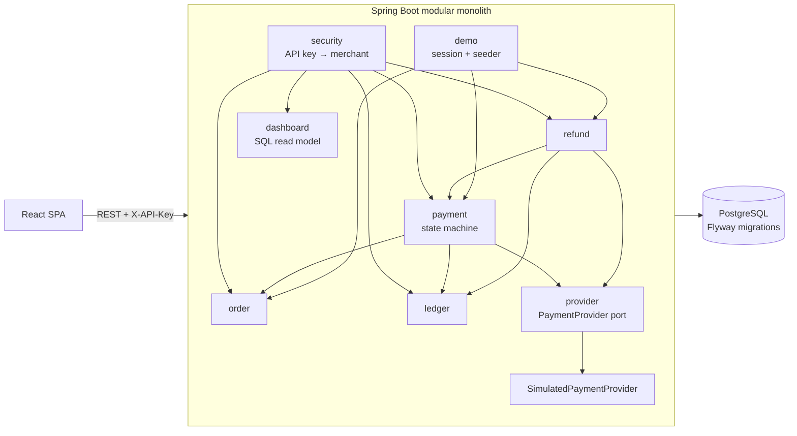
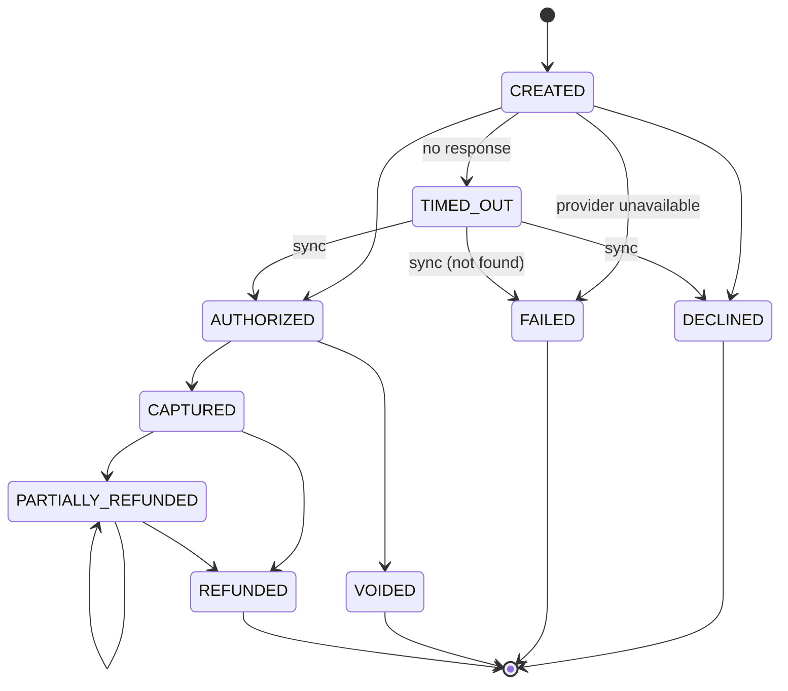

# FinFlow

> **Simulation only.** FinFlow is a portfolio project that simulates payment orchestration. It uses a simulated
> payment provider, fake payment-method tokens and synthetic data. It never moves real money and never accepts card
> numbers or CVVs.

FinFlow lets a merchant create orders, run payments against a simulated provider (success, decline, timeout, outage),
capture or void authorizations, issue partial and full refunds, and inspect every state transition and the
double-entry ledger, with a live dashboard computed from stored data.

**Status: Phase 1 (end-to-end MVP).** Kafka, webhooks, reconciliation, Redis, metrics and deployment are later phases.

| | |
|---|---|
| Backend | Java 21, Spring Boot 4.1, Spring Data JPA / Hibernate 7, Spring Security, Flyway, springdoc-openapi |
| Database | PostgreSQL 17 |
| Frontend | React 19 + TypeScript, Vite, TanStack Query, React Router |
| Tests | JUnit 5, AssertJ, MockMvc, Testcontainers (real PostgreSQL), Vitest |

---

## Quick start

Prerequisites: **JDK 21+**, **Node 20+**, **Docker** (for PostgreSQL and the integration tests).

```bash
# 1. Configuration (placeholders only; .env is git-ignored)
cp .env.example .env

# 2. PostgreSQL on localhost:5433
docker compose up -d postgres

# 3. Backend on http://localhost:8080 (applies Flyway migrations, seeds the demo merchant)
cd backend && ./mvnw spring-boot:run

# 4. Frontend on http://localhost:5173 (proxies /api to the backend)
cd frontend && npm install && npm run dev
```

Open http://localhost:5173 and click **Enter demo merchant**. Demo data is generated in the background during the
first ~15 seconds after startup. The dashboard refreshes itself.

- Swagger UI: http://localhost:8080/swagger-ui.html (get a key from `POST /api/v1/demo/session`, then *Authorize*)
- OpenAPI JSON: http://localhost:8080/v3/api-docs
- Health: http://localhost:8080/actuator/health

### Tests

```bash
cd backend && ./mvnw test      # 48 tests: unit + integration (needs Docker running for Testcontainers)
cd frontend && npm test        # money parsing/formatting unit tests
cd frontend && npm run build   # type-check + production build
```

### Configuration

All configuration comes from environment variables (see [.env.example](.env.example)). The backend also reads
`../.env` via `spring.config.import`, so the same file drives Docker Compose and Spring.

| Variable | Default | Purpose |
|---|---|---|
| `DB_URL`, `DB_USERNAME`, `DB_PASSWORD` | – | PostgreSQL connection |
| `FINFLOW_CORS_ALLOWED_ORIGINS` | `http://localhost:5173` | Allowed browser origins (comma-separated) |
| `FINFLOW_DEMO_ENABLED` / `FINFLOW_DEMO_SEED` | `true` / `true` | Demo session endpoint / sample data |
| `FINFLOW_DEMO_API_KEY` | random per start | Fixed demo key, only needed with several instances |
| `FINFLOW_SIMULATOR_LATENCY_MS` | `120` | Artificial latency per provider call |
| `FINFLOW_SIMULATOR_TIMEOUT_MS` | `1500` | How long `tok_timeout` hangs before failing |
| `FINFLOW_SIMULATOR_OUTAGE` | `false` | Every provider call fails as unavailable |
| `FINFLOW_REFUND_WINDOW_DAYS` | `180` | Refunds allowed up to N days after capture |

---

## Architecture

A **modular monolith**: one deployable Spring Boot app, split into packages with clear responsibilities and
one-directional dependencies. Nothing here needs independent scaling or deployment yet, so separate services would
add network failure modes without benefit.



| Package | Responsibility |
|---|---|
| `common` | Error model (RFC 9457 problem details + stable `code`), pagination envelope, request-id filter, audit base entity |
| `security`, `merchant` | API-key authentication (keys stored as SHA-256), merchant principal, CORS, OpenAPI config |
| `order` | Orders: unique merchant reference per merchant, `OPEN → PAID` |
| `payment` | Payment aggregate, state machine, transaction history, orchestration against the provider |
| `refund` | Refund eligibility rules (`RefundPolicy`), reservation → provider → confirmation flow |
| `ledger` | Double-entry journals (`Journal` enforces debits = credits), balances and per-currency checks |
| `provider` | `PaymentProvider` port and the in-memory simulator driven by fake tokens |
| `dashboard` | KPIs computed live with SQL aggregates |
| `demo` | Shared demo merchant, demo session endpoint, sample-data seeder |

### Payment state machine



The allowed transitions live in one table in [PaymentStatus.java](backend/src/main/java/com/finflow/payment/PaymentStatus.java).
Every status change goes through a method on [Payment.java](backend/src/main/java/com/finflow/payment/Payment.java)
that validates it and returns the history event to persist. API responses include `availableActions` derived from the
same table, so the UI never re-implements the rules.

### Key design decisions (interview notes)

- **Money is `BIGINT` minor units + ISO currency** everywhere: DB, Java `long`, JSON integers. The frontend converts
  display strings with string arithmetic, never floats.
- **No DB transaction is held across a provider call.** Each operation is: short transaction (validate, record
  intent) → provider call with no locks → short transaction that re-locks the row (`SELECT … FOR UPDATE`) and applies
  the result. The state machine re-validates in the second step, so concurrent changes are detected, not overwritten.
- **Timeouts are not failures.** A timed-out authorization has an *unknown* outcome, so the payment becomes
  `TIMED_OUT`, not `FAILED`. It still blocks new payments for the order, and is resolved by `POST /payments/{id}/sync`,
  which asks the provider. A blind retry could double-charge. A status lookup cannot.
- **Idempotency.** `POST /payments` and `POST /payments/{id}/refunds` require an `Idempotency-Key`. A repeat returns
  the original resource (`200`, `Idempotent-Replayed: true`). The same key with a different body is a `409`. The UI
  generates one key per attempt and keeps it across network errors.
- **The database enforces the invariants too, not only Java:**
  - a partial unique index allows only one *active* payment (created/authorized/timed-out/captured/refunded) per order
    → no double charge, even under races;
  - `UNIQUE (merchant_id, idempotency_key)` on payments and refunds;
  - `CHECK (refunded ≤ captured ≤ amount)` on payments;
  - partial unique indexes so a capture or refund journal can be posted to the ledger only once;
  - foreign keys everywhere, `CHECK` constraints on every enum column.
- **No over-refunds under concurrency.** A refund is first reserved as a `PENDING` row under the payment's row lock and
  counted against the refundable amount. An integration test fires 8 concurrent refunds at one payment and asserts
  exactly the affordable ones succeed.
- **Double-entry ledger.** Capture: debit `PROVIDER_RECEIVABLE`, credit `MERCHANT_BALANCE`. Refund: the reverse.
  `Journal` cannot be constructed unbalanced. Entries are immutable and posted in the same transaction as the state
  change that caused them.
- **Merchant scoping.** Every repository lookup takes the `merchantId` from the authenticated principal. Another
  merchant's resources return `404`, not `403`, to avoid leaking existence.
- **API keys** are 256-bit random secrets stored only as SHA-256 hashes (a slow password hash is unnecessary for
  high-entropy keys and would prevent indexed lookup). The demo key is regenerated at each startup and kept in memory.
- **Consistent errors.** Every error, including Spring's own (bad JSON, 405, validation, 401), is
  `application/problem+json` with `code`, `detail`, optional field `errors` and the `requestId` that appears in logs.

---

## API examples

```bash
API=http://localhost:8080/api/v1
KEY=$(curl -s -X POST $API/demo/session | jq -r .apiKey)

# Create an order (amount in minor units: 4990 = 49.90)
ORDER=$(curl -s $API/orders -H "X-API-Key: $KEY" -H 'Content-Type: application/json' \
  -d '{"merchantReference":"ORD-1001","amountMinor":4990,"currency":"USD","description":"Pour-over kit"}' | jq -r .id)

# Authorize only (manual capture) with a fake token
PAYMENT=$(curl -s $API/payments -H "X-API-Key: $KEY" -H 'Content-Type: application/json' \
  -H "Idempotency-Key: $(uuidgen)" \
  -d "{\"orderId\":\"$ORDER\",\"paymentMethodToken\":\"tok_success\",\"captureMode\":\"MANUAL\"}" | jq -r .id)

curl -s -X POST $API/payments/$PAYMENT/capture -H "X-API-Key: $KEY" | jq '{status, availableActions}'

# Partial refund
curl -s $API/payments/$PAYMENT/refunds -H "X-API-Key: $KEY" -H 'Content-Type: application/json' \
  -H "Idempotency-Key: $(uuidgen)" -d '{"amountMinor":1000,"reason":"Damaged box"}' | jq '{status, amountMinor}'

# History, ledger, dashboard
curl -s $API/payments/$PAYMENT/events -H "X-API-Key: $KEY" | jq '.[] | {type, fromStatus, toStatus}'
curl -s "$API/ledger/entries?paymentId=$PAYMENT" -H "X-API-Key: $KEY" | jq '.content[] | {account, direction, amountMinor}'
curl -s $API/dashboard/summary -H "X-API-Key: $KEY" | jq '{totalPayments, authorizationRatePercent}'

# An invalid transition is rejected by the backend
curl -s -X POST $API/payments/$PAYMENT/void -H "X-API-Key: $KEY"
# {"type":"https://finflow.dev/errors/invalid-state-transition","status":409,
#  "detail":"Cannot void a payment in status PARTIALLY_REFUNDED","code":"INVALID_STATE_TRANSITION",...}
```

### Endpoints

| Method | Path | Notes |
|---|---|---|
| POST | `/api/v1/demo/session` | Public. Demo merchant API key (demo mode only) |
| GET | `/api/v1/simulator/scenarios` | Public. Fake tokens and their outcomes |
| GET | `/api/v1/merchants/me` | Current merchant |
| POST / GET | `/api/v1/orders` | Create / list (`status`, `page`, `size`) |
| GET | `/api/v1/orders/{id}` | |
| POST | `/api/v1/payments` | Requires `Idempotency-Key` |
| GET | `/api/v1/payments` | Filters: `status`, `orderId`; paginated |
| GET | `/api/v1/payments/{id}` / `/events` | Payment with `availableActions` / transition history |
| POST | `/api/v1/payments/{id}/capture` · `/void` · `/sync` | State-machine actions |
| POST / GET | `/api/v1/payments/{id}/refunds` | POST requires `Idempotency-Key`; omit `amountMinor` to refund the rest |
| GET | `/api/v1/ledger/entries` · `/balances` | `paymentId` filter; balances include a debits = credits check |
| GET | `/api/v1/dashboard/summary` | Live KPIs, 14-day series, failure reasons |

### Simulator tokens

| Token | Outcome |
|---|---|
| `tok_success` | Approved |
| `tok_decline_insufficient_funds` / `tok_decline_do_not_honor` / `tok_decline_expired_card` | Declined with that code |
| `tok_timeout` | Provider approves but never answers → `TIMED_OUT`; `sync` later finds it authorized |
| `tok_provider_unavailable` | Connection refused → `FAILED`; safe to retry with a new payment |

---

## Tests

| Kind | What it covers |
|---|---|
| Unit | Full transition table; `Payment` domain methods; refund policy (status, window, pending reservations); journal balancing; simulator outcomes |
| Integration (Testcontainers PostgreSQL + MockMvc) | Success with history + ledger; decline then retry; manual capture; invalid transitions (409); void; partial/full/over-refund; idempotent replay and key reuse; timeout + sync; provider outage; dashboard numbers; merchant isolation; 401s; validation errors; card numbers rejected; demo session; OpenAPI published; concurrent refunds; seeder consistency (ledger balanced) |
| Frontend | Money parsing/formatting without floating point |

---

## Known limitations (Phase 1)

- **Simulator state is in memory.** After a restart it forgets authorizations, so syncing a payment that timed out
  before the restart resolves it as `FAILED (not_found_at_provider)`.
- **Payments stuck in `CREATED`** (process crash between the two transactions) are not swept automatically yet. That
  is a reconciliation job for a later phase.
- **Refund timeouts are treated as failures** (the simulator never produces them). A real system would keep them
  `PENDING` and confirm with the provider.
- Full capture only (no partial capture), no fees or FX in the ledger, no settlement/payouts.
- The shared demo merchant is writable by every visitor and has **no rate limiting** yet (planned with Redis).
- The demo API key is regenerated at each startup, so open browser sessions return to the welcome screen after a
  backend restart. Set `FINFLOW_DEMO_API_KEY` for multi-instance deployments.
- Demo seed data is produced by the real flows, then its timestamps are shifted back over 14 days so the dashboard has
  history. That shift is the only part not produced by normal use.
- No webhooks, events, reconciliation reports or operational metrics yet (later phases).
