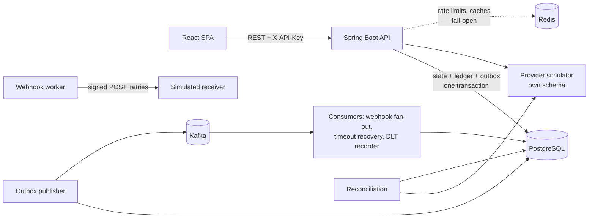

# FinFlow

> **Simulation only.** FinFlow is a portfolio project that simulates payment orchestration. It uses a simulated
> payment provider, fake payment-method tokens and synthetic data. It never moves real money and never accepts card
> numbers or CVVs.

FinFlow lets a merchant create orders, run payments against a simulated provider (success, decline, timeout, outage,
crash), capture or void authorizations, issue partial and full refunds, and inspect every state transition, the
double-entry ledger, signed webhook deliveries with retries, and reconciliation reports against the provider's
independent records, with a live dashboard computed from stored data.

**Status: Phase 2 (reliability).** Phase 1 MVP plus durable idempotency, a database-enforced ledger, transactional
outbox → Kafka, webhooks, reconciliation, Redis (rate limits/caches), metrics/tracing and load tests.
Deployment is Phase 3.

| Document | Contents |
|---|---|
| [docs/ARCHITECTURE.md](docs/ARCHITECTURE.md) | Components, sequence diagrams, delivery guarantees, ledger model, failure scenarios |
| [docs/OPERATIONS.md](docs/OPERATIONS.md) | Runbook: Kafka/Redis outages, dead-letter replay, ledger corrections, reconciliation |
| [loadtest/README.md](loadtest/README.md) | k6 workload and measured results |

| | |
|---|---|
| Backend | Java 21, Spring Boot 4.1, Spring Data JPA / Hibernate 7, Spring Security, Flyway, springdoc-openapi |
| Messaging | Apache Kafka 4.2 (KRaft), Spring Kafka, transactional outbox |
| Data | PostgreSQL 17 (source of truth), Redis 8.6 (rate limits and caches only) |
| Observability | Micrometer + Prometheus, OpenTelemetry tracing (OTLP → Jaeger), Grafana dashboard |
| Frontend | React 19 + TypeScript, Vite, TanStack Query, React Router |
| Tests | JUnit 5, Mockito, AssertJ, Awaitility, Testcontainers (PostgreSQL, Kafka, Redis), Vitest, k6 |

---

## Quick start

Prerequisites: **JDK 21+**, **Node 20+**, **Docker** (for PostgreSQL and the integration tests).

```bash
# 1. Configuration (placeholders only; .env is git-ignored)
cp .env.example .env

# 2. PostgreSQL :5433, Kafka :9092, Redis :6380   (add --profile monitoring for Prometheus/Grafana/Jaeger)
docker compose up -d

# 3. Backend on http://localhost:8080 (applies Flyway migrations, seeds the demo merchant)
cd backend && ./mvnw spring-boot:run

# 4. Frontend on http://localhost:5173 (proxies /api to the backend)
cd frontend && npm install && npm run dev
```

Open http://localhost:5173 and click **Enter demo merchant**. Demo data is generated in the background during the
first ~15 seconds after startup (orders, payments, refunds, webhook deliveries, three injected provider anomalies and
an initial reconciliation run). The dashboard refreshes itself.

- Swagger UI: http://localhost:8080/swagger-ui.html (get a key from `POST /api/v1/demo/session`, then *Authorize*)
- OpenAPI JSON: http://localhost:8080/v3/api-docs
- Health: http://localhost:8080/actuator/health/readiness · Metrics: http://localhost:8080/actuator/prometheus
- With `--profile monitoring`: Grafana http://localhost:3000 ("FinFlow overview"), Prometheus :9090, Jaeger :16686

### Tests

```bash
cd backend && ./mvnw test      # 101 tests: unit + integration (needs Docker: starts PostgreSQL, Kafka, Redis)
cd frontend && npm test        # money parsing/formatting unit tests
cd frontend && npm run build   # type-check + production build
```

### Configuration

All configuration comes from environment variables (see [.env.example](.env.example)). The backend also reads
`../.env` via `spring.config.import`, so the same file drives Docker Compose and Spring.

| Variable | Default | Purpose |
|---|---|---|
| `DB_URL`, `DB_USERNAME`, `DB_PASSWORD` | – | PostgreSQL connection |
| `FINFLOW_CORS_ALLOWED_ORIGINS` | `http://localhost:5173` | Allowed browser origins (comma-separated) |
| `FINFLOW_DEMO_ENABLED` / `FINFLOW_DEMO_SEED` | `true` / `true` | Demo session endpoint / sample data |
| `FINFLOW_DEMO_API_KEY` | random per start | Fixed demo key, only needed with several instances |
| `FINFLOW_SIMULATOR_LATENCY_MS` | `120` | Artificial latency per provider call |
| `FINFLOW_SIMULATOR_TIMEOUT_MS` | `1500` | How long `tok_timeout` hangs before failing |
| `FINFLOW_SIMULATOR_OUTAGE` | `false` | Every provider call fails as unavailable |
| `FINFLOW_REFUND_WINDOW_DAYS` | `180` | Refunds allowed up to N days after capture |
| `KAFKA_BOOTSTRAP_SERVERS`, `KAFKA_SECURITY_PROTOCOL`, `KAFKA_SASL_*` | `localhost:9092`, `PLAINTEXT` | Kafka connection (managed Kafka via SASL_SSL) |
| `REDIS_URL` | `redis://localhost:6379` (`.env.example`: 6380) | Redis; optional, everything fails open |
| `FINFLOW_OPS_TOKEN` | empty (ops API disabled) | Token for `/api/ops/**` |
| `FINFLOW_WEBHOOK_RETRY_SCHEDULE` | `2s,10s,30s,2m,10m` | Delay before each webhook retry |
| `FINFLOW_RATE_LIMIT_RPM` / `_WRITES_PM` / `_PUBLIC_PM` | `300` / `60` / `60` | Per-merchant / per-merchant writes / per-IP public limits |
| `FINFLOW_RECONCILIATION_INTERVAL`, `_STALE_AFTER` | `10m`, `60s` | Scheduled reconciliation; age before a record counts as stuck |
| `FINFLOW_LOG_FORMAT` | empty (text) | `ecs` or `logstash` for JSON logs |
| `FINFLOW_TRACING_EXPORT_ENABLED`, `OTEL_EXPORTER_OTLP_TRACES_ENDPOINT` | `false`, `:4318` | OTLP trace export |

---

## Architecture

A **modular monolith**: one deployable Spring Boot app whose packages have clear responsibilities, plus Kafka
consumers, an outbox publisher and a webhook worker running as background threads in the same process. Full diagrams
(components, payment sequence, outbox flow, refunds and ledger, reconciliation, failure recovery) are in
[docs/ARCHITECTURE.md](docs/ARCHITECTURE.md).



### Key design decisions (interview notes)

- **Money is `BIGINT` minor units + ISO currency** everywhere: DB, Java `long`, JSON integers. The frontend converts
  display strings with string arithmetic, never floats.
- **No DB transaction is held across a provider call.** Short transaction (validate, record intent) → provider call
  with no locks → short transaction that re-locks the row (`SELECT … FOR UPDATE`) and applies the result. The state
  machine re-validates in the second step, so concurrent changes are detected, not overwritten.
- **Timeouts are not failures.** A timed-out authorization has an *unknown* outcome → `TIMED_OUT`, which still blocks
  new payments for the order. It is resolved by asking the provider (Kafka consumer after 5 s, manual `sync`, or
  reconciliation), never by blindly retrying.
- **Durable idempotency.** `idempotency_records` stores key, operation, SHA-256 request fingerprint and the original
  response. Repeat → same status and body with `Idempotent-Replayed: true`; different body → `409
  IDEMPOTENCY_KEY_REUSED`; while running → `409 IDEMPOTENCY_REQUEST_IN_PROGRESS`; crashed request → lease expires and a
  retry takes over. Payment/refund rows keep their own unique key as a second, permanent guard.
- **Invariants live in PostgreSQL, not only Java:** one active payment per order (partial unique index), unique
  idempotency keys, `refunded ≤ captured ≤ amount`, each capture/refund posted to the ledger once, every journal
  balanced at COMMIT (deferred constraint trigger), ledger rows append-only (trigger).
- **No over-refunds under concurrency:** a refund is reserved as a `PENDING` row under the payment's row lock.
- **Transactional outbox:** the event row commits with the state change; publishing to Kafka is at-least-once;
  consumers are idempotent. Not end-to-end exactly-once, and webhook receivers must dedupe on `FinFlow-Event-Id`.
- **Reconciliation against independent provider records** repairs what is provably safe (timeouts, crashes between
  provider call and commit) and reports the rest (duplicate/orphan/missing charges, ledger mismatches) for a human.
- **Redis is optional.** Rate limits and caches fail open with 250 ms timeouts; no financial state is ever in Redis.
- **Merchant scoping** on every query; other merchants' resources return `404`. **Operator functions** need a separate
  `X-Ops-Token`, so the shared demo key cannot reach them.
- **Consistent errors:** every error is `application/problem+json` with `code`, `detail`, optional `errors` and the
  `requestId` that also appears in logs, Kafka headers and webhook deliveries.

---

## API examples

```bash
API=http://localhost:8080/api/v1
KEY=$(curl -s -X POST $API/demo/session | jq -r .apiKey)

# Create an order (amount in minor units: 4990 = 49.90)
ORDER=$(curl -s $API/orders -H "X-API-Key: $KEY" -H 'Content-Type: application/json' \
  -d '{"merchantReference":"ORD-1001","amountMinor":4990,"currency":"USD","description":"Pour-over kit"}' | jq -r .id)

# Authorize only (manual capture) with a fake token. Re-running this exact command with the same key replays it.
IDEM=$(uuidgen)
PAYMENT=$(curl -s $API/payments -H "X-API-Key: $KEY" -H 'Content-Type: application/json' -H "Idempotency-Key: $IDEM" \
  -d "{\"orderId\":\"$ORDER\",\"paymentMethodToken\":\"tok_success\",\"captureMode\":\"MANUAL\"}" | jq -r .id)

curl -s -X POST $API/payments/$PAYMENT/capture -H "X-API-Key: $KEY" | jq '{status, availableActions}'

# Partial refund
curl -s $API/payments/$PAYMENT/refunds -H "X-API-Key: $KEY" -H 'Content-Type: application/json' \
  -H "Idempotency-Key: $(uuidgen)" -d '{"amountMinor":1000,"reason":"Damaged box"}' | jq '{status, amountMinor}'

# History, ledger, webhooks, reconciliation
curl -s $API/payments/$PAYMENT/events -H "X-API-Key: $KEY" | jq '.[] | {type, fromStatus, toStatus}'
curl -s "$API/ledger/entries?paymentId=$PAYMENT" -H "X-API-Key: $KEY" | jq '.content[] | {account, direction, amountMinor}'
curl -s "$API/webhook-deliveries?paymentId=$PAYMENT" -H "X-API-Key: $KEY" | jq '.content[] | {eventType, status, attemptCount}'
curl -s -X POST $API/reconciliation/runs -H "X-API-Key: $KEY" | jq '{findings: .run.findingsTotal, types: [.findings[].type]}'

# An invalid transition is rejected by the backend
curl -s -X POST $API/payments/$PAYMENT/void -H "X-API-Key: $KEY"
# {"type":"https://finflow.dev/errors/invalid-state-transition","status":409,
#  "detail":"Cannot void a payment in status PARTIALLY_REFUNDED","code":"INVALID_STATE_TRANSITION",...}
```

### Endpoints

| Method | Path | Notes |
|---|---|---|
| POST | `/api/v1/demo/session` | Public. Demo merchant API key (demo mode only) |
| GET | `/api/v1/simulator/scenarios` | Public. Fake tokens and their outcomes |
| GET | `/api/v1/merchants/me` | Current merchant |
| POST / GET | `/api/v1/orders` · `/api/v1/orders/{id}` | Create / list (`status`, `page`, `size`) / get |
| POST | `/api/v1/payments` | Requires `Idempotency-Key` |
| GET | `/api/v1/payments` · `/{id}` · `/{id}/events` | Filters `status`, `orderId`; `availableActions`; history |
| POST | `/api/v1/payments/{id}/capture` · `/void` · `/sync` | State-machine actions; optional `Idempotency-Key` on capture/void |
| POST / GET | `/api/v1/payments/{id}/refunds` | POST requires `Idempotency-Key`; omit `amountMinor` to refund the rest |
| GET | `/api/v1/ledger/entries` · `/balances` | `paymentId` filter; balances include a debits = credits check |
| GET | `/api/v1/dashboard/summary` | Live KPIs, 14-day series, failure reasons |
| POST / GET | `/api/v1/webhook-endpoints` · `/{id}/enable` · `/{id}/disable` | Simulated receiver endpoints (secret shown once) |
| GET / POST | `/api/v1/webhook-deliveries` · `/{id}` · `/{id}/redeliver` | Deliveries with attempt history |
| POST / GET | `/api/v1/reconciliation/runs` · `/{id}` · `/{id}/report.csv` | Run, list, report |
| * | `/api/ops/**` | Operator only (`X-Ops-Token`), see [docs/OPERATIONS.md](docs/OPERATIONS.md) |

### Simulator tokens

| Token | Outcome |
|---|---|
| `tok_success` | Approved |
| `tok_decline_insufficient_funds` / `tok_decline_do_not_honor` / `tok_decline_expired_card` | Declined with that code |
| `tok_timeout` | Provider approves but never answers → `TIMED_OUT`, resolved automatically after ~5 s or via `sync` |
| `tok_provider_unavailable` | Connection refused → `FAILED`; safe to retry with a new payment |
| `tok_crash_after_provider_approval` | Fault injection: FinFlow "crashes" after the provider approved; the payment stays `CREATED` until reconciliation recovers it |

---

## Tests

101 backend tests (`./mvnw test`) and 19 frontend tests. Highlights:

| Kind | What it covers |
|---|---|
| Unit (JUnit, Mockito) | Full transition table; payment/refund rules; journal balancing; simulator decisions with mocked storage; reconciliation matcher (every finding type); webhook signatures; rate limiter fail-open; recovery consumer idempotency |
| Integration (Testcontainers: PostgreSQL, Kafka, Redis) | All Phase 1 flows; 12 simultaneous identical requests → 1 payment; retry during a provider timeout; stored 4xx replay; key release on 5xx; crash + retry; abandoned key takeover |
| Ledger integrity | DB rejects unbalanced journals and UPDATE/DELETE/TRUNCATE; no double posting; reversal once only, visible to reconciliation |
| Event pipeline | Outbox per state change; duplicate Kafka delivery → no duplicate webhook; retries with history; permanent failure + redelivery + receiver dedup; worker crash lease; consumer restart; poison → DLT → replay; async timeout recovery |
| Failure injection (Mockito spies, paused containers) | Outbox failure rolls back state + ledger; real Kafka outage; crash after Kafka ack; consumer retry; crash after provider refund; Redis outage |
| Load (k6) | See [loadtest/README.md](loadtest/README.md) for measured results |

---

## Known limitations

- Single simulated provider; no provider routing/failover. The provider's records live in the same PostgreSQL
  instance (separate schema, independent transactions), not a separate system.
- Outbox publisher, consumers and webhook worker run inside the API process; not packaged as a separate worker.
- Event order per payment is normal but not guaranteed after a failed send (publisher pipelines batches).
- Reconciliation loads a merchant's whole history per run; a real system would reconcile per settlement file.
- Webhook signing secrets are stored in plaintext (required for HMAC; production would encrypt with a KMS key).
- Refund timeouts are treated as failures (the simulator never produces them).
- Full capture only, no fees or FX in the ledger, no settlement/payouts.
- The demo API key is regenerated at each startup unless `FINFLOW_DEMO_API_KEY` is set; required for >1 instance.
- Demo seed data is produced by the real flows, then its timestamps are shifted back over 14 days (the ledger permits
  this only under an explicit transaction-local flag). Three provider anomalies are injected on purpose.
