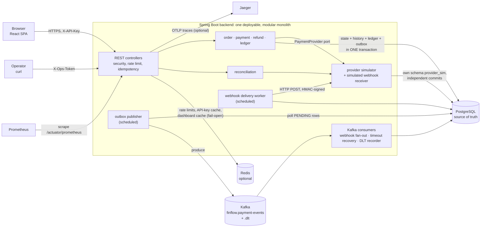
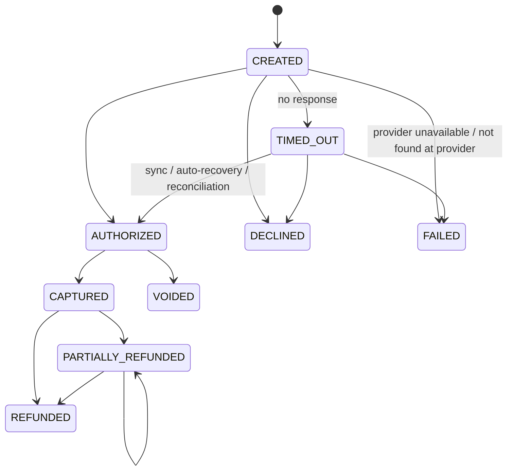
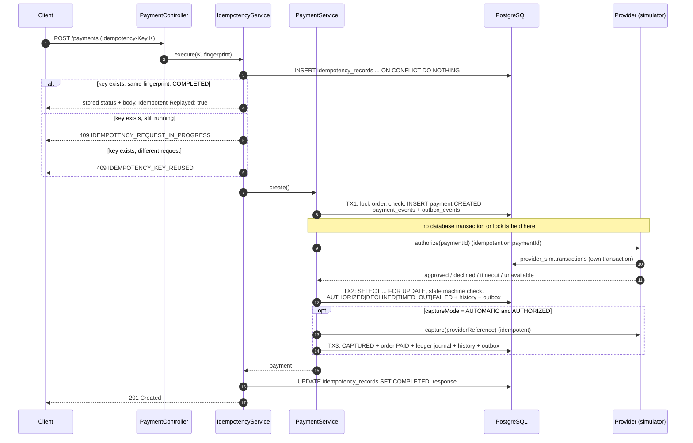
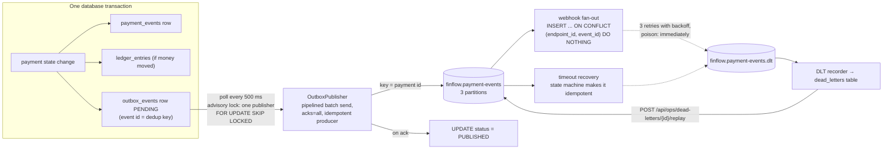
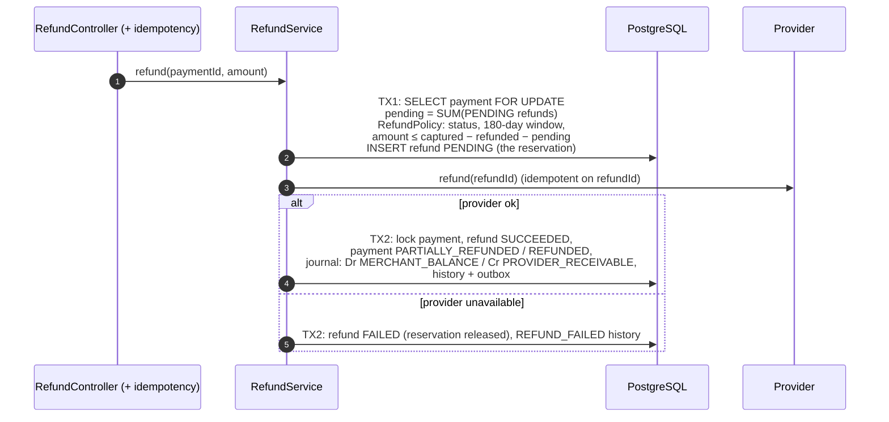
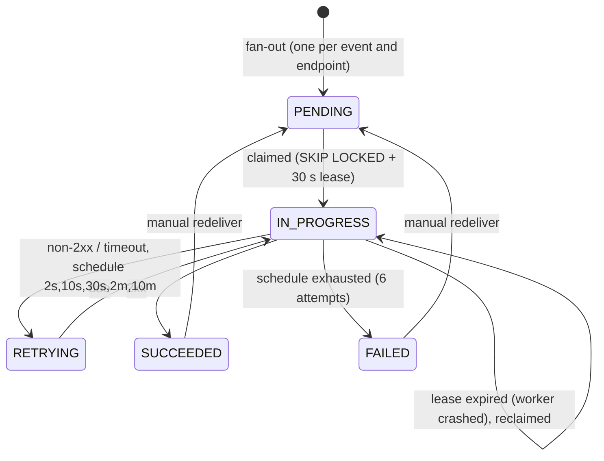
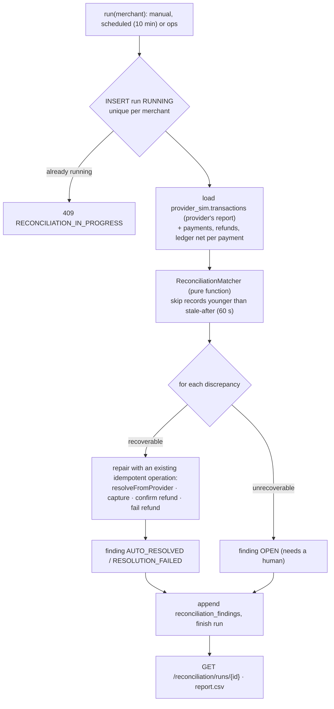
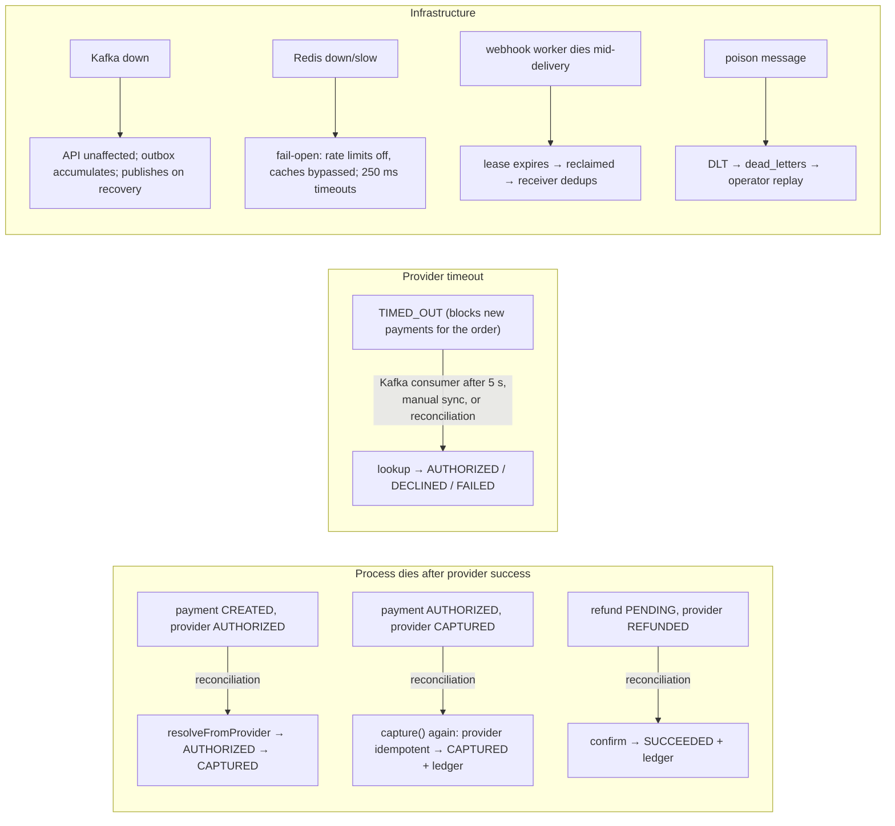
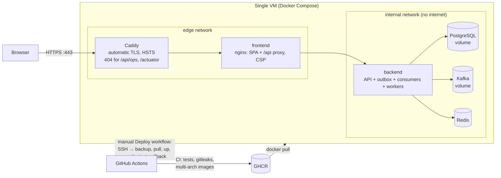

# FinFlow architecture

This document describes what is implemented in this repository. Every box in the diagrams is
a real package, table, topic or process. Nothing here is aspirational; see
[Known limitations](#known-limitations) for what is not built.

FinFlow is a **simulation**: the "payment provider" is an in-process simulator with its own
database schema, and no real money or card data is involved.

## 1. System context and components

Everything runs in one JVM. The Kafka consumers, the outbox publisher and the webhook worker
are separate threads in the same process, so they share the deployable but not the request path.
This keeps the system easy to run and debug while still exercising real asynchronous boundaries
(a broker, at-least-once delivery, consumer groups).

| Package | Responsibility |
|---|---|
| `security`, `merchant`, `ratelimit` | API-key auth (SHA-256 hashed keys, Redis-cached lookup), ops-token auth, per-merchant and per-IP rate limits |
| `idempotency` | `idempotency_records`: key, operation, request fingerprint, stored response, in-flight lease |
| `order` | Orders (`OPEN → PAID`), unique merchant reference |
| `payment` | Payment aggregate and state machine, transaction history, orchestration against the provider |
| `refund` | Refund eligibility (`RefundPolicy`), reserve → provider → confirm flow |
| `ledger` | Double-entry journals, reversals, balances. Balance and immutability also enforced by DB triggers |
| `outbox` | Outbox writer (same transaction) and publisher (to Kafka) |
| `events` | Event envelope, Kafka error handling and DLT, timeout-recovery consumer, dead-letter recorder |
| `webhook` | Endpoints, fan-out consumer, delivery worker with retries, signing, simulated receiver |
| `provider` | `PaymentProvider` port, simulator with durable records in schema `provider_sim`, metered decorator |
| `reconciliation` | Pure matcher + service that repairs safe cases and writes an append-only report |
| `dashboard` | KPIs computed with SQL, cached briefly in Redis |
| `ops` | Operator endpoints: dead-letter replay, outbox re-queue, ledger reversal, reconciliation trigger |

## 2. Payment lifecycle

The table lives in `PaymentStatus`. A partial unique index on `payments(order_id)` allows only
one payment per order in `CREATED, AUTHORIZED, TIMED_OUT, CAPTURED, PARTIALLY_REFUNDED, REFUNDED`.
That is the double-charge guard, and `TIMED_OUT` is included because its outcome is unknown.

## 3. Creating a payment

If the process dies between the provider call and TX2/TX3, the provider has a record that FinFlow
lacks. That gap is closed by the timeout-recovery consumer (for `TIMED_OUT`) and by reconciliation
(for `CREATED`, `AUTHORIZED`-but-captured and `PENDING` refunds). See §7.

## 4. Transactional outbox → Kafka → consumers

**Delivery guarantees, stated precisely:**

- The business change and its event commit atomically (same PostgreSQL transaction).
- Publishing is **at-least-once**. A crash after Kafka acknowledges but before the row is marked
  `PUBLISHED` re-sends the event. Tested: `FailureInjectionIntegrationTest`.
- Consumers are **idempotent** (unique keys or the payment state machine), so a duplicate has no
  additional effect. Together this gives *effectively-once processing for these specific effects*.
  It is **not** end-to-end exactly-once: a webhook receiver can still see the same event more than
  once and must deduplicate on `FinFlow-Event-Id`.
- **Ordering:** events are keyed by payment id, so one payment's events share a partition and
  normally arrive in order. Not guaranteed when a send fails and is retried later (the publisher
  pipelines batches). No consumer depends on order; each event carries a full payment snapshot and
  its `createdAt`.
- A Kafka outage does not affect the API. Events wait in the outbox (`finflow_outbox_lag_seconds`)
  and publish when the broker returns. Tested by pausing the Kafka container.

## 5. Refunds and the ledger

The `PENDING` row under the payment's row lock is what stops concurrent refunds from exceeding the
captured amount (tested with 8 parallel refunds).

### Ledger model

| Event | Debit | Credit |
|---|---|---|
| Capture | `PROVIDER_RECEIVABLE` (asset: the provider owes us) | `MERCHANT_BALANCE` (liability: we owe the merchant) |
| Refund | `MERCHANT_BALANCE` | `PROVIDER_RECEIVABLE` |
| Reversal (correction) | mirror of the original journal, every direction swapped | |

Invariants and where they are enforced:

| Invariant | Java | PostgreSQL |
|---|---|---|
| Every journal balances, one currency | `Journal` constructor | deferred constraint trigger `trg_ledger_journal_balanced`, checked at COMMIT |
| Entries are immutable | `@Immutable` entity | trigger `trg_ledger_append_only` rejects UPDATE/DELETE/TRUNCATE |
| A capture/refund is posted once | flow design | partial unique indexes `ux_ledger_capture_once`, `ux_ledger_refund_once` |
| A journal is reversed at most once | `LedgerService.reverse` | `ux_ledger_reversal_once` |
| Ledger moves with the state change | MANDATORY propagation | same transaction |

**Ledger vs payment status.** The payment row is the *current state* of one business object and
is updated in place (`CAPTURED` → `PARTIALLY_REFUNDED`). The ledger is an *append-only record of
money movements* between accounts. It is never updated, it sums to zero, and balances are derived
from it. If they disagree (e.g. a capture journal was reversed but the payment still says
`CAPTURED`), reconciliation reports `LEDGER_MISMATCH`.

## 6. Webhook delivery

Each request carries `FinFlow-Event-Id` (dedup key), `FinFlow-Delivery-Id`, `FinFlow-Event-Type`
and `FinFlow-Signature: t=<unix>,v1=HMAC-SHA256(secret, t + "." + body)`. Every attempt is stored
in `webhook_delivery_attempts`. In the public demo, endpoints can only target the built-in
simulated receiver (external URLs need an operator allowlist, to prevent SSRF). Redirects are not
followed.

## 7. Reconciliation

| Finding | Example cause | Handling |
|---|---|---|
| `UNRESOLVED_PAYMENT` | timeout, or crash after the provider approved | auto: look up at provider, apply |
| `STATUS_MISMATCH` (AUTHORIZED here, captured there) | crash after a successful capture | auto: re-run capture (idempotent at provider) |
| `PENDING_REFUND` | crash after provider refund / before provider call | auto: confirm, or fail and release |
| `DUPLICATE_PROVIDER_CAPTURE` | provider charged twice | open: refund the duplicate at the provider |
| `MISSING_AT_PROVIDER` | provider lost a capture | open: investigate |
| `ORPHAN_PROVIDER_TRANSACTION` | provider charge with no FinFlow payment | open: investigate / refund |
| `STATUS_MISMATCH` (DECLINED/FAILED here, authorized there) | funds held for a "failed" payment | open: void at provider |
| `AMOUNT_MISMATCH` | captured/refunded amounts differ | open |
| `LEDGER_MISMATCH` | ledger receivable ≠ captured − refunded | open: correct with a reversal |

The demo seeder injects one duplicate capture, one lost capture and one orphan capture into the
provider's records (flagged in `provider_sim.transactions.injected_anomaly`), so the report always
has unrecoverable findings to show.

## 8. Failure recovery scenarios (all covered by tests)

| Scenario | Test |
|---|---|
| 12 identical concurrent payment requests → 1 payment, 1 provider authorization | `IdempotencyIntegrationTest` |
| Retry while the first request is still waiting on a timeout | `IdempotencyIntegrationTest` |
| Outbox write fails → payment, ledger and event all roll back | `FailureInjectionIntegrationTest` |
| Kafka paused → API works, events publish after recovery | `FailureInjectionIntegrationTest` |
| Crash after Kafka ack, before marking published → no duplicate effects | `FailureInjectionIntegrationTest` |
| Consumer stopped and restarted → no lost events | `EventPipelineIntegrationTest` |
| Duplicate Kafka delivery → no duplicate webhook | `EventPipelineIntegrationTest` |
| Webhook worker crash → lease reclaim | `EventPipelineIntegrationTest` |
| Redis paused → payments, refunds, ledger still correct | `RedisOutageIntegrationTest` |
| Unbalanced journal / UPDATE on ledger rejected by the database | `LedgerIntegrityIntegrationTest` |

## 9. Redis usage

| Use | Key / TTL | Invalidation | If Redis is unavailable |
|---|---|---|---|
| Rate limiting (fixed window, Lua INCR+PEXPIRE) | `rl:{bucket}:{subject}:{window}` / 1 min | expiry | fail-open: requests allowed, `finflow_redis_failures_total` incremented |
| API key → merchant | `cache:apikey:{sha256}` / 5 min | evicted on key rotation; TTL bounds staleness | read from PostgreSQL |
| Dashboard summary | `cache:dashboard:{merchantId}` / 10 s | evicted after any payment change commits | computed from PostgreSQL |

Redis never holds payment, refund, ledger or idempotency state; uniqueness and financial invariants
are enforced only by PostgreSQL. Lettuce timeouts are 250 ms, so a hung Redis slows requests
slightly but cannot stall them (measured in `RedisOutageIntegrationTest`). Redis is excluded from the
readiness probe. Trade-off: if an eviction fails during an outage, a rotated API key can stay valid
for up to the 5-minute TTL.

## 10. Observability

- **Logs:** `requestId` (from `X-Request-Id` or generated) and `traceId` in every line. The request id
  travels into outbox rows, Kafka headers and webhook deliveries, so one id follows a payment
  through the async path. `FINFLOW_LOG_FORMAT=ecs` switches to JSON.
- **Traces:** Micrometer Tracing with the OpenTelemetry bridge: spans for HTTP requests and for Kafka
  produce/consume (observation enabled on the template and listeners), so a trace links the API
  call to the consumer that processed its event. Export via OTLP to Jaeger when `FINFLOW_TRACING_EXPORT_ENABLED=true`.
- **Metrics** (`/actuator/prometheus`): `finflow_payment_events_total{type}`,
  `finflow_payment_processing_seconds`, `finflow_provider_latency_seconds{operation,outcome}`,
  `finflow_outbox_pending|failed|lag_seconds`, `finflow_kafka_consumer_retries|dead_lettered|duplicates_total`,
  Kafka client lag (`kafka_consumer_fetch_manager_records_lag_max`),
  `finflow_webhook_attempts_total{outcome}`, `finflow_webhook_retries_scheduled_total`,
  `finflow_webhook_deliveries_failed_total`, `finflow_webhook_deliveries_due`,
  `finflow_reconciliation_runs|findings_total`, `finflow_idempotency_requests_total{result}`,
  `finflow_redis_failures_total`, `finflow_ratelimit_rejected_total`.
- **Health:** `/actuator/health/liveness`, `/actuator/health/readiness` (readiness = database only).
- **Local stack:** `docker compose --profile monitoring up -d` → Grafana on :3000 with the provisioned
  "FinFlow overview" dashboard, Prometheus on :9090, Jaeger on :16686.

## 11. Deployment view

**Not deployed publicly.** This is the target topology, verified locally with
`deploy/docker-compose.prod.yml` (see [PROJECT_GUIDE.md §15](PROJECT_GUIDE.md#15-deployment)).

## Known limitations

- One provider (the simulator); no routing or failover between providers.
- The outbox publisher, consumers and worker run inside the API process. They can be split into a
  separate worker deployment by configuration, but that is not packaged.
- Reconciliation loads a merchant's full history into memory; a real system would reconcile per
  settlement period.
- Webhook signing secrets are stored in plaintext (needed for HMAC); production would encrypt them.
- Full capture only; no fees, FX, settlement or payouts in the ledger.
- Refund timeouts are treated as failures (the simulator never produces them).
